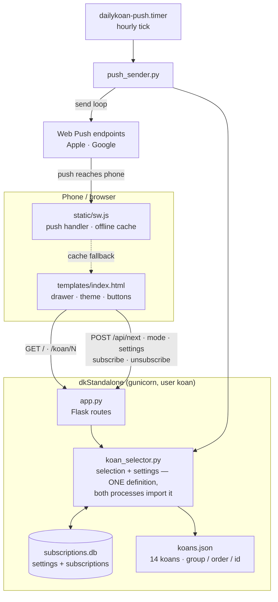
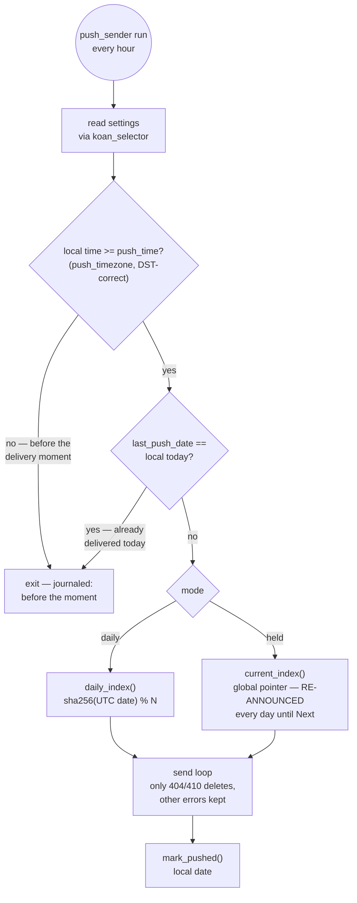

# Daily Koan PWA — File Map (Doc 000)

Version: 000 — llm
Status: CURRENT as of 0.1.6 (2026-11-17)
Related: docs/adr/ (the *why*), docs/002--llm--TWEAKS.md (the 0.1.6 change set), docs/003--llm--KOAN_PROGRESSION.md (what comes next)

Purpose: one glance at the load-bearing files. Everything else is support and stays plain text at the bottom — the diagrams stay simple. Mermaid renders natively on GitHub; locally use a VS Code Mermaid extension or paste into mermaid.live.

## 1. Runtime — who talks to whom

Read it top to bottom — request path first, push path second. The page asks `app.py` for koans and posts setting changes; `app.py` never touches state directly — `koan_selector.py` is the only reader/writer of `koans.json` and the DB. Then, every hour, the timer fires `push_sender.py`, which reuses the *same* selector — so the web app and the push can never disagree on which koan is current.

## 2. One decision, made fresh every run

The point of `koan_selector.py`: mode and delivery schedule are data, so no decision is ever remembered between runs. The hourly run asks three questions in order:

`GET /` answers with the same two branches (daily shows today's hash koan; held shows the pointer). `POST /api/next` calls `advance()` — `BEGIN IMMEDIATE`, atomic `+1` with wrap — and 409s in daily mode, where the pointer is meaningless.

## 3. Support files (deliberately off the diagrams)

| File | What it is |
| --- | --- |
| `init_db.py` | creates the schema + seeds settings (idempotent; app startup does the same, so this is belt-and-suspenders) |
| `init_vapid.py` | generates `vapid_*.pem` — gitignored, irreplaceable (data-model ADR: rotation = re-subscribe event) |
| `init_icons.py` | placeholder PWA icon generator |
| `mockup.html` | static design reference — lags 0.1.6; the template is the source of truth |
| `tests/` | 56 unit tests — delivery gate, selection state, routes, payload truncate |
| `requirements.txt` · `pyproject.toml` | deps; ruff targets `py39` (the venv runs 3.9.6) |
| `static/manifest.json` | PWA manifest |
| `docs/` + `AGENTS.md` | specs, deploy runbook (001.2), ADRs, this map; agent workflow rules |

Reading order for a fresh session: `koan_selector.py` → `app.py` → `templates/index.html` → `push_sender.py`. That is the whole machine; the table above is everything that only helps build it.