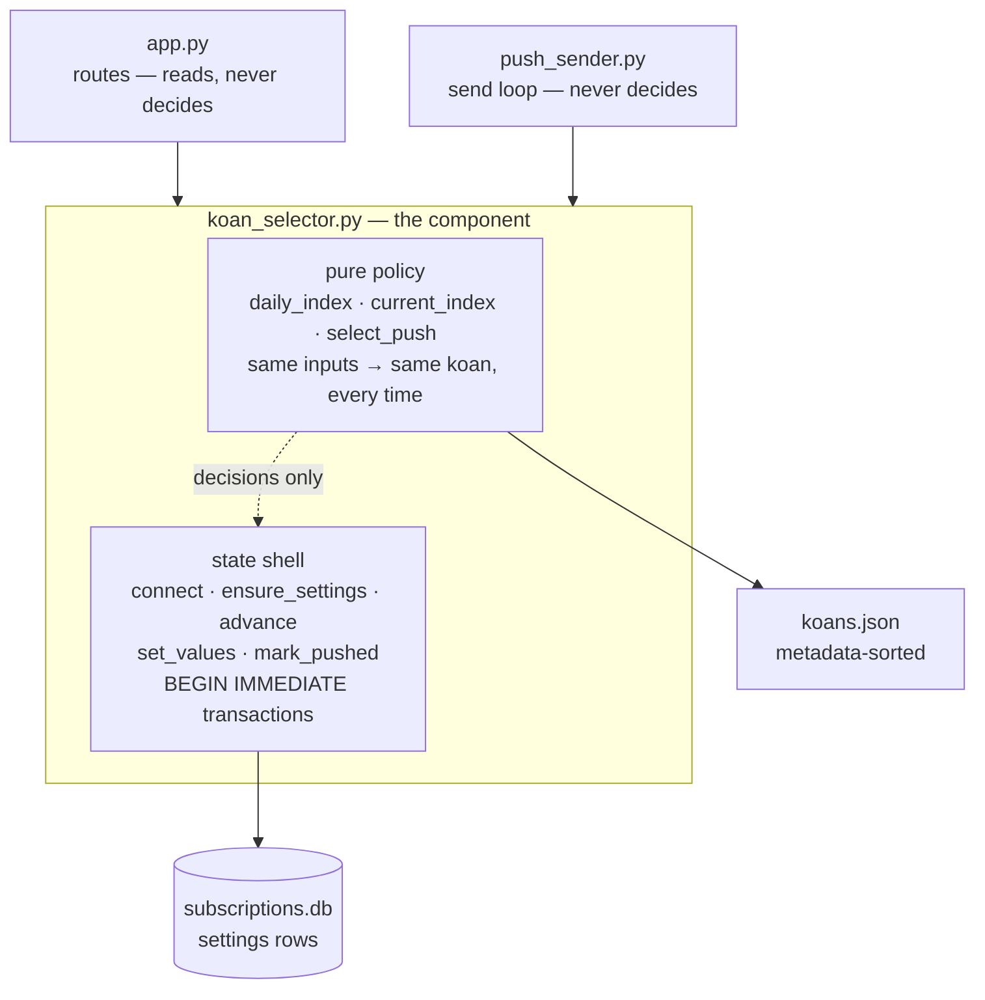

# Daily Koan PWA — Componentizing the Determinism (Doc 002b)

Version: 002 — llm
Status: CURRENT as of 0.1.6 (2026-11-17). Written as a focused companion to docs/003 §5 (componentization verdict for the same-koan logic) and docs/002--llm--TWEAKS.md Tweak 1.
Related: docs/adr/data-model.md, docs/adr/push-pipeline.md, docs/000--diagram--llm.md

Purpose: answer "can the determinism — the logic that adds complexity — be componentized, and what is the status?" in one place, separating what the complexity actually *is* from where it lives now.

## 1. What the determinism is, precisely

Two rules decide which koan the world sees, both in `koan_selector.py`:

1. **Daily mode — stateless determinism.** `daily_index(total, date)` = `sha256(UTC date) % total`. Same day → same koan on every machine, in both processes. Nothing remembered.
2. **Held mode — stateful determinism.** `current_index(settings, total)` = the stored pointer. Everyone sees the same koan *because the pointer is global*, and it moves only via `advance()` (atomic, `BEGIN IMMEDIATE`).

The **complexity is not the hash** — that is 3 lines of referentially transparent code. The complexity determinism *adds* to the system is the coordination around it:

| Added by | Complexity | Lives |
| --- | --- |
| Two selection rules | mode branching in `current_index`, `select_push`, `advance` (409) | `koan_selector.py` |
| "Exactly one push per day/advance" | dedupe keys `last_push_date` / `last_push_index`, mode-switch clearing in `set_values` | `koan_selector.py` + DB |
| Global same-koan pointer | shared mutable state, atomic advance, clamp-on-read | `koan_selector.py` + DB |
| 08:00 UTC boundary | clock sourcing, UTC-only dates | `time.gmtime()` defaults |

Strip the coordination away and "determinism" is one pure function plus one remembered fact per mode. That is already the minimal shape — a day boundary is an external fact of the world, and exactly-once requires comparing against *something* remembered. Neither is componentizable away; both are irreducible.

## 2. Current componentization (status: done at the module level, 0.1.6)

Facts, not aspiration:

- **One definition, two consumers.** Before 0.1.6, selection existed twice (`app.py` and `push_sender.py`) and had already drifted. Now both import `koan_selector`; there is exactly one code path that can decide the current koan. This was the actual unnecessary complexity, and it is gone.
- **The policy core is pure.** `daily_index(total, date)`, `current_index(settings, total, date)`, and `select_push(koans, settings, date)` are referentially transparent: no hidden mutable state, DB path and date injectable as parameters, all three tested without a real clock.
- **The state shell is the only place that writes.** `advance` / `set_values` / `mark_pushed` own every transaction; `app.py` routes and the `push_sender` send loop never touch the settings rows directly.
- **Migration is shared, not duplicated.** `ensure_settings` is idempotent + `BEGIN IMMEDIATE`, safe to run from any process, any time.

## 3. Ability — what further componentization is possible, and worth what

| Level | Shape | Status / verdict |
| --- | --- | --- |
| L0 — shared module | functions, injectable `db_path` / `date` / `rng` | **done** (current state) |
| L1 — policy/state split | `selector_policy.py` (pure, no sqlite import) beside `selector_state.py` (transactions) | **available, not warranted** — the split already exists informally (§2); formalizing it buys import-level purity, but the policy tests already run DB-free. Worth it only when a *third* consumer appears (API bot, second site) that wants decisions without the state shell |
| L2 — class / port-adapter | `KoanSelector(clock, store)` injected | **rejected as ceremony** — module functions already provide every seam the tests need; a class adds indirection with no new capability at N=1 |
| Cross-cutting | move dedupe policy (mode-switch clearing) into `select_push`'s definition | **rejected deliberately** — `set_values` clearing on mode switch is a *write-side* invariant; keeping it next to the writes it guards is the legible place |

## 4. The one hidden dependency worth naming

`daily_index` and `select_push` default `date=None` → `time.gmtime()` (wall clock). The pure core exists, but a caller who omits the date reaches around it. Status: accepted and documented — callers in production *should* use "today", tests inject dates, and a injected-clock refactor (L1/L2) would not change a single behavior, only the shape. It is a naming-of-costs item, not a defect.

## 5. Verdict

Ability: **yes, and it is done** — at the level the system actually needed (one module, pure policy core, single writer surface). Status: **incidental complexity removed** (the duplicate implementations, file-order coupling, read-modify-write races — all gone in 0.1.6); **essential complexity remains and is where it belongs** (mode as data, dedupe keys, atomic advance — one definition each, tested). Further componentization (L1/L2) exists as an option with a concrete trigger: a third consumer of the decision logic. Until one appears, the module *is* the component.

## For dummies

The "everyone sees the same koan" trick is two small rules: a page-a-day formula, and a shared bookmark everyone reads. The hard part was never the rules — it was making sure the website and the phone-alert script never disagree, and that a day never double-sends. Both used to keep their own copy of the rules and had already drifted apart; now there is one copy, both use it, and the drift is impossible. That was the componentizing. Anything fancier (classes, layers) would be decoration nobody asked for.